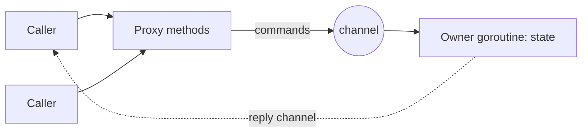

# Active Object

<!-- meta -->
Run all operations on an object one at a time, in the order they arrive, while callers either continue or wait for the result.

<div class="cp-props" markdown>

| | |
|---|---|
| Also known as | Concurrent Object |
| Purpose | [Execution](../catalog/purpose.md#purpose-execution) |
| Scale | [Composite](../catalog/scale.md#scale-composite) |
| Mechanisms | [Channels](../catalog/mechanism.md#mechanism-channels), [Select](../catalog/mechanism.md#mechanism-select), [Context](../catalog/mechanism.md#mechanism-context) |
| Concerns | [Data race safety](../catalog/concern.md#concern-data-race-safety), [Composition](../catalog/concern.md#concern-composition) |
| Concepts | [Confinement](../concepts/confinement.md), [Goroutine Leak Prevention](../concepts/goroutine-leak-prevention.md), [Memory Visibility](../concepts/memory-visibility.md), [Ordering](../concepts/ordering.md) |
| Code | [`patterns/activeobject`](https://github.com/johnknl/go-concurrency-patterns/tree/main/patterns/activeobject) |

</div>
<!-- /meta -->

## Problem

An object is read and changed from many goroutines. A lock around each field works until the object has several
fields that must change together, or operations that must not interleave. Callers need the operations to run one at
a time in a single order, without each caller having to take part in the locking.
The owner goroutine is close to an actor in the
[actor model](../sources.md#source-hewitt-1973).

## Mechanism

The whole object moves into one goroutine, the owner: the order of operations is the order in which commands arrive, and
nothing else can touch the state. The state is a local variable of the owner goroutine
([confinement by an owner goroutine](../concepts/confinement.md#owner-goroutine)). The proxy offers ordinary
methods; each builds a command and sends it on a channel. A command that needs an answer carries a reply channel with
capacity 1, which the method waits on. The owner loops with `select` and executes one command per iteration. In this
example the object is a bank account with deposit, withdraw, and balance commands.



<!-- code: patterns/activeobject#deposit patterns/activeobject#withdraw patterns/activeobject#balance patterns/activeobject#account patterns/activeobject#newAccount patterns/activeobject#account.run patterns/activeobject#account.send patterns/activeobject#account.Deposit patterns/activeobject#account.Withdraw patterns/activeobject#account.Balance patterns/activeobject#Example_activeObject:main -->
```go
type deposit struct{ amount int }

type withdraw struct {
	reply  chan error
	amount int
}

type balance struct{ reply chan int }

type account struct {
	commands chan any
	done     chan struct{}
}

func newAccount(ctx context.Context) *account {
	a := &account{commands: make(chan any), done: make(chan struct{})}
	go a.run(ctx)

	return a
}

func (a *account) run(ctx context.Context) {
	defer close(a.done)

	total := 0

	for {
		select {
		case <-ctx.Done():
			return
		case command := <-a.commands:
			switch c := command.(type) {
			case deposit:
				total += c.amount
			case withdraw:
				if c.amount > total {
					c.reply <- errInsufficient
					continue
				}

				total -= c.amount
				c.reply <- nil
			case balance:
				c.reply <- total
			}
		}
	}
}

func (a *account) send(command any) bool {
	select {
	case a.commands <- command:
		return true
	case <-a.done:
		return false
	}
}

func (a *account) Deposit(amount int) error {
	if !a.send(deposit{amount}) {
		return errStopped
	}

	return nil
}

func (a *account) Withdraw(amount int) error {
	reply := make(chan error, 1)
	if !a.send(withdraw{amount: amount, reply: reply}) {
		return errStopped
	}

	return <-reply
}

func (a *account) Balance() (int, error) {
	reply := make(chan int, 1)
	if !a.send(balance{reply}) {
		return 0, errStopped
	}

	return <-reply, nil
}

func main() {
	ctx, cancel := context.WithCancel(context.Background())
	acct := newAccount(ctx)

	var wg sync.WaitGroup
	for range 100 {
		wg.Go(func() { _ = acct.Deposit(10) })
	}

	wg.Wait()

	total, _ := acct.Balance()
	fmt.Println("balance:", total)
	fmt.Println("withdraw 5000:", acct.Withdraw(5000))
	fmt.Println("withdraw 400:", acct.Withdraw(400))

	cancel()
	<-acct.done

	_, err := acct.Balance()
	fmt.Println("after stop:", err)

	// Output:
	// balance: 1000
	// withdraw 5000: insufficient funds
	// withdraw 400: <nil>
	// after stop: account stopped
}
```
<!-- /code -->

What makes it correct:

- **Ordering.** The send happens before the owner executes the command, and the reply is sent after, so the caller
  observes the effect without further synchronization
  ([memory visibility](../concepts/memory-visibility.md#send-before-receive)). Commands from one goroutine run in the
  order sent; commands from different goroutines run in one total order, decided by when the owner receives them
  ([ordering](../concepts/ordering.md#sequential-fifo)).
- **A stopped owner.** Every send also selects on `done`, which the owner closes when it ends
  ([the end is observable](../concepts/goroutine-leak-prevention.md#observable-end)), so a call made after the owner
  has stopped returns `errStopped` instead of blocking forever.
- **The reply buffer** is defensive: each method always receives its reply, but the buffer protects the owner from
  a caller that stops waiting ([reply buffer of one](../concepts/goroutine-leak-prevention.md#reply-buffer-one)).
- **No escape.** The proxy never hands out the state; queries return copies.

## Composition

<!-- composition -->
- [For-Select Loop](for-select-loop.md): the owner is a loop that waits for a command or for cancellation.
- [Future](future.md): the reply channel is a placeholder that the caller waits on.
- [Snapshot via Owner](snapshot-via-owner.md): reading the state is a command that returns a copy, as `Balance` does.
<!-- /composition -->

## Applicability

Use it when the state has invariants across several fields or operations that must not interleave, when the object
also does work of its own (timers, background refresh) in the same loop, or when operations are better modeled as
messages that are queued, logged, or replayed. A [mutex](https://pkg.go.dev/sync#Mutex) is simpler for a counter, a
cache, or any state whose operations are short and independent; an owner is worth it only with work of its own
([confinement](../concepts/confinement.md#owner-has-work)), and one for such state is
[Channel Instead of Mutex](../anti-patterns/channel-instead-of-mutex.md).

## Consequences

- No locks: the state is confined, and the race detector has nothing to find in it.
- Each call is a channel round trip and a goroutine switch, which costs more than an uncontended mutex.
- The owner is a bottleneck: throughput is that of one goroutine, and callers queue behind each other
  ([owner costs](../concepts/confinement.md#owner-costs)).
- A command that blocks, on I/O or on a call back into the proxy, stops every other caller. Keep commands short,
  and never call the object's own proxy from a command.
- The object has a lifetime: something must stop the owner, and callers must handle a stopped owner.
- Commands that return pointers or maps into the state break confinement.

## Related patterns

- [Monitor](monitor.md) protects shared state with a lock instead of a goroutine; callers run the operations
  themselves.
- An aggregate root in domain-driven design (Evans) is also a consistency boundary: all changes go through one
  entry point, and the invariants hold after each of them. The aggregate is about the transactional consistency of
  a graph of domain objects and implies no goroutine; concurrent access is usually left to the transaction or to
  optimistic locking. The active object serializes concurrent access itself, by running every command in one
  goroutine. An aggregate can be implemented as an active object, but neither requires the other.

## Anti-patterns

<!-- antipatterns -->
- [Inconsistent Lock Order](../anti-patterns/inconsistent-lock-order.md): Take two locks in different orders in different goroutines, so each can hold one while waiting for the other, and both wait forever.
- [Lock Held While Blocking](../anti-patterns/lock-held-while-blocking.md): Hold a mutex across a channel operation, I/O or a callback, so everyone else who needs the lock waits, and a deadlock follows if the other side needs it too.
<!-- /antipatterns -->

## Sources

The catalog entry in [Schmidt et al. (2000)](../sources.md#source-schmidt-2000) describes the pattern with a
scheduler and an activation queue; here a channel and a goroutine replace them.

<!-- sources -->
- [Schmidt et al. (2000)](../sources.md#source-schmidt-2000), Active Object
- [Hewitt et al. (1973)](../sources.md#source-hewitt-1973)
<!-- /sources -->
