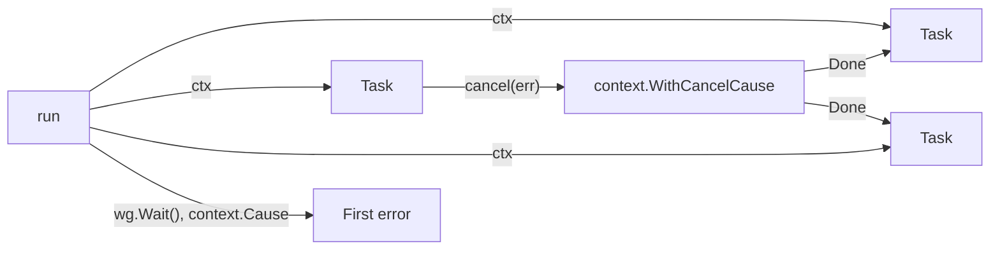

# Cancel on Error

<!-- meta -->
When one of several concurrent tasks fails, stop the others and report the error that caused it.

<div class="cp-props" markdown>

| | |
|---|---|
| Also known as | Cancel on First Error, Fail fast, Error group |
| Purpose | [Resilience](../catalog/purpose.md#purpose-resilience) |
| Scale | [Pattern](../catalog/scale.md#scale-pattern) |
| Mechanisms | [Sync](../catalog/mechanism.md#mechanism-sync), [Context](../catalog/mechanism.md#mechanism-context) |
| Concerns | [Error handling](../catalog/concern.md#concern-error-handling), [Cancellation](../catalog/concern.md#concern-cancellation) |
| Concepts | [Cooperative Cancellation](../concepts/cooperative-cancellation.md) |
| Code | [`patterns/cancelonerr`](https://github.com/johnknl/go-concurrency-patterns/tree/main/patterns/cancelonerr) |

</div>

!!! note "Library"
    [`golang.org/x/sync/errgroup`](https://pkg.go.dev/golang.org/x/sync/errgroup) implements this pattern; use it instead of writing `run` by hand.
<!-- /meta -->

## Problem

Several goroutines work toward one result. When one fails, the result cannot be produced and the work of the others
is wasted. Waiting for all of them delays the error by the slowest task, and the caller should see the error that
caused the failure, not the `context canceled` errors of the tasks stopped because of it.

## Mechanism

In this example, `run` derives a context with `context.WithCancelCause` and starts every task with it under a
`sync.WaitGroup`. A task that fails calls the cancel function with its error. Only the first call takes effect, so the
other tasks see `ctx.Done()` close and `context.Cause` keeps the first error. `run` waits for all tasks, so no goroutine
outlives it, and returns `context.Cause(ctx)`: `nil` if no task failed, otherwise the first error (`ctx.Err()` alone
reports only `context canceled`). If the parent context is canceled, the tasks stop too and `run` returns the parent's
cause ([return the cause](../concepts/cooperative-cancellation.md#return-cause)).



<!-- code: patterns/cancelonerr#run patterns/cancelonerr#Example_firstError:main -->
```go
func run(ctx context.Context, tasks ...func(context.Context) error) error {
	ctx, cancel := context.WithCancelCause(ctx)
	defer cancel(nil)

	var wg sync.WaitGroup
	for _, task := range tasks {
		wg.Go(func() {
			if err := task(ctx); err != nil {
				cancel(err)
			}
		})
	}
	wg.Wait()

	return context.Cause(ctx)
}

func main() {
	errCorrupt := errors.New("corrupt index")

	task := func(id int) func(context.Context) error {
		return func(ctx context.Context) error {
			if id == 2 {
				return fmt.Errorf("task %d: %w", id, errCorrupt)
			}

			<-ctx.Done()
			fmt.Println("task", id, "stopped")

			return ctx.Err()
		}
	}

	err := run(context.Background(), task(1), task(2), task(3))

	fmt.Println(err)
	fmt.Println(errors.Is(err, errCorrupt))

	// Unordered output:
	// task 1 stopped
	// task 3 stopped
	// task 2: corrupt index
	// true
}
```
<!-- /code -->

`errgroup.WithContext` does exactly this, and adds `SetLimit` to bound the number of running tasks.

## Applicability

Use it when the tasks are parts of one result, any failure makes the result useless, and the tasks watch the
context, so canceling them saves work. To collect every task's error instead, see
[Result with Error](result-with-error.md).

## Consequences

- The caller sees one error; errors of other tasks that failed at the same time are dropped.
- `run` returns only after the slowest task notices the cancellation, so tasks that ignore the context delay it
  ([ignoring the context delays the waiter](../concepts/cooperative-cancellation.md#ignore-delays)).
- Canceling only signals the tasks ([signal, not effect](../concepts/cooperative-cancellation.md#signal-not-effect)),
  and canceled tasks may leave partial work behind; it must be undone or idempotent
  ([consistent state](../concepts/cooperative-cancellation.md#consistent-state)).

## Related patterns

- [Result with Error](result-with-error.md) returns errors from goroutines to the code that decides.
- [Deadline](../stdlib/deadline.md) and [Context Propagation](../stdlib/context-propagation.md) are the other ways
  the tasks' context ends.
- [Close with Cause](close-with-cause.md) carries a cause with a cancellation.

## Sources

<!-- sources -->
Original work.
<!-- /sources -->
