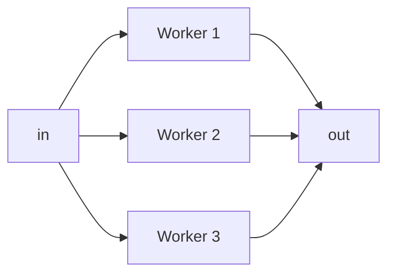

# Fan-Out/Fan-In

<!-- meta -->
Process independent items at the same time and collect all their results.

<div class="cp-props" markdown>

| | |
|---|---|
| Purpose | [Data flow](../catalog/purpose.md#purpose-data-flow) |
| Scale | [Pattern](../catalog/scale.md#scale-pattern) |
| Mechanisms | [Channels](../catalog/mechanism.md#mechanism-channels), [Sync](../catalog/mechanism.md#mechanism-sync) |
| Concerns | [Throughput](../catalog/concern.md#concern-throughput), [Latency](../catalog/concern.md#concern-latency) |
| Concepts | [Channel Ownership](../concepts/channel-ownership.md), [Ordering](../concepts/ordering.md), [Goroutine Leak Prevention](../concepts/goroutine-leak-prevention.md) |
| Code | [`patterns/fanout`](https://github.com/johnknl/go-concurrency-patterns/tree/main/patterns/fanout) |

</div>
<!-- /meta -->

## Problem

A stream of independent work items is handled one at a time, although any item could be handled by any of several
interchangeable workers. The work has to be distributed among the workers and their results collected into one
stream again.

## Mechanism

Fan-out: several workers receive from the same channel, and each value goes to exactly one of them. Workers compete
for values, so one that finishes early takes the next, which balances uneven work. Fan-in: the workers send to one
shared output channel. That channel is owned by a closer that waits for every worker to return and then closes it
([closer waits](../concepts/channel-ownership.md#closer-waits)); a worker never closes it
([the sender closes](../concepts/channel-ownership.md#sender-closes)).



<!-- code: patterns/fanout#Example_workers:main -->
```go
func main() {
	in := emit(1, 2, 3, 4, 5, 6, 7, 8)
	out := make(chan int)

	var wg sync.WaitGroup

	for range 3 {
		wg.Go(func() {
			for n := range in {
				out <- n * n
			}
		})
	}

	go func() {
		wg.Wait()
		close(out)
	}()

	var squares []int
	for n := range out {
		squares = append(squares, n)
	}

	slices.Sort(squares) // completion order is not defined
	fmt.Println(squares)

	// Output:
	// [1 4 9 16 25 36 49 64]
}
```
<!-- /code -->

## Applicability

Use it when items are independent, results may arrive out of order, and the work is expensive enough that more
concurrency raises throughput, because it waits on I/O or has spare cores
([Premature Parallelism](../anti-patterns/premature-parallelism.md)). When the work is a slice known up front, start
one goroutine per item with a `sync.WaitGroup` and write each result to its own index; no channels are needed. A
slow [Pipeline](pipeline.md) stage is a common place for it. The in-memory source in the examples stands
in for one that blocks on its own ([Channel Generator](../anti-patterns/channel-generator.md)).

## Consequences

- Throughput grows with the number of workers until the resource they wait on (cores, a database, a remote
  service) is saturated.
- Results arrive in completion order, not input order ([fan-out loses order](../concepts/ordering.md#fan-out-loses);
  restore it with [per-key](../concepts/ordering.md#per-key) sequence numbers).
- The number of workers is fixed for the lifetime of the stream.
- The workers and `merge` send without a `select`, so if the consumer stops reading early they block forever
  ([unread output](../concepts/goroutine-leak-prevention.md#unread-output)); add a context, as in
  [Pipeline](pipeline.md), when that can happen ([select on
  done](../concepts/goroutine-leak-prevention.md#select-on-done)).

## Variants

### Merge existing channels

When the inputs are separate channels, run one forwarding goroutine per input. Values from one input keep their
order; the output closes after the last input closes.

<!-- code: patterns/fanout#merge patterns/fanout#Example_merge:main -->
```go
func merge(inputs ...<-chan int) <-chan int {
	out := make(chan int)

	var wg sync.WaitGroup

	for _, in := range inputs {
		wg.Go(func() {
			for n := range in {
				out <- n
			}
		})
	}

	go func() {
		wg.Wait()
		close(out)
	}()

	return out
}

func main() {
	var all []int
	for n := range merge(emit(1, 2), emit(3), emit(4, 5, 6)) {
		all = append(all, n)
	}

	slices.Sort(all)
	fmt.Println(all)

	// Output:
	// [1 2 3 4 5 6]
}
```
<!-- /code -->

## Related patterns

- [Worker Pool](worker-pool.md) uses the same mechanism for jobs that carry their own result.
- [Resequencer](resequencer.md) restores the input order of the results.
- [Request Racing](request-racing.md) sends the same request to several workers and keeps the first
  result; here each value goes to one worker.

## Anti-patterns

<!-- antipatterns -->
- [Premature Parallelism](../anti-patterns/premature-parallelism.md): Spread cheap work on data that is already in hand across goroutines and channels, so the handoffs cost more than the work, the order is lost, and a loop's worth of code becomes a pipeline to manage.
<!-- /antipatterns -->

## Sources

<!-- sources -->
- [Cox-Buday (2017)](../sources.md#source-cox-buday), Ch. 4, "Fan-Out, Fan-In"
- [Ajmani (2014b)](../sources.md#source-blog-pipelines), "Fan-out, fan-in"
- [Pike (2012)](../sources.md#source-pike-2012), Fan-in
<!-- /sources -->
