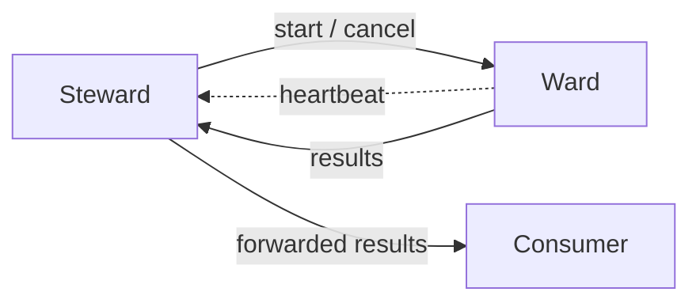

# Healing Goroutines

<!-- meta -->
Detect a stuck worker and restart it.

<div class="cp-props" markdown>

| | |
|---|---|
| Also known as | Supervisor, Watchdog |
| Purpose | [Resilience](../catalog/purpose.md#purpose-resilience) |
| Scale | [Pattern](../catalog/scale.md#scale-pattern) |
| Mechanisms | [Channels](../catalog/mechanism.md#mechanism-channels), [Select](../catalog/mechanism.md#mechanism-select), [Time](../catalog/mechanism.md#mechanism-time), [Context](../catalog/mechanism.md#mechanism-context) |
| Concerns | [Liveness](../catalog/concern.md#concern-liveness) |
| Concepts | [Channel Ownership](../concepts/channel-ownership.md), [Cooperative Cancellation](../concepts/cooperative-cancellation.md) |
| Code | [`patterns/healing`](https://github.com/johnknl/go-concurrency-patterns/tree/main/patterns/healing) |

</div>
<!-- /meta -->

## Problem

A goroutine can get stuck, for example on a call that never returns. Goroutines cannot be killed from outside, but
one that respects its context can be canceled and a new one started in its place, without callers noticing.

## Mechanism

The ward is a function that starts a goroutine and returns its heartbeat and results channels, so the steward can
start it again. The steward starts the ward with a context of its own and selects on a result, a pulse, or the
timeout; every pulse starts a new timeout. When the timeout fires, the steward cancels the ward, waits for its
heartbeat channel to close, and only then starts a new ward, so two wards never run at once. When the ward ends on
its own, or the steward's context is canceled, the steward closes `out` and returns.



Setting `results` to `nil` once it is closed is essential, or the loop would spin ([a closed channel is always
ready](../concepts/channel-ownership.md#closed-always-ready)). The steward's forward to `out` also selects on its
context ([blocking points select on Done](../concepts/cooperative-cancellation.md#blocking-selects-done)), and the
closed heartbeat tells it that the ward has ended ([close
broadcasts](../concepts/channel-ownership.md#close-broadcasts)). The timeout is a function returning a channel; a
program would use one that closes after a duration (for example via `time.AfterFunc`). In this example the timeout is
controlled so the first ward is stuck until canceled and the second finishes.

<!-- code: patterns/healing#ward patterns/healing#steward patterns/healing#Example_restart:main -->
```go
type ward func(ctx context.Context) (<-chan struct{}, <-chan int)

func steward(ctx context.Context, timeout func() <-chan struct{}, start ward) <-chan int {
	out := make(chan int)

	go func() {
		defer close(out)

		for {
			wardCtx, cancel := context.WithCancel(ctx)
			heartbeat, results := start(wardCtx)
			expired := timeout()

		watch:
			for {
				select {
				case <-ctx.Done():
					cancel()
					return
				case _, ok := <-heartbeat:
					if !ok {
						cancel()
						return
					}

					expired = timeout()
				case n, ok := <-results:
					if !ok {
						results = nil

						continue
					}

					select {
					case out <- n:
					case <-ctx.Done():
						cancel()
						return
					}
				case <-expired:
					cancel()

					for range heartbeat {
					}

					break watch
				}
			}
		}
	}()

	return out
}

func main() {
	ctx, cancel := context.WithCancel(context.Background())
	defer cancel()

	runs := 0

	start := func(ctx context.Context) (<-chan struct{}, <-chan int) {
		runs++
		run := runs

		heartbeat := make(chan struct{}, 1)
		results := make(chan int)

		go func() {
			defer close(heartbeat)
			defer close(results)

			if run == 1 {
				fmt.Println("ward 1: stuck")
				<-ctx.Done()
				fmt.Println("ward 1: canceled")

				return
			}

			for n := range 3 {
				select {
				case heartbeat <- struct{}{}:
				default:
				}

				select {
				case results <- n:
				case <-ctx.Done():
					return
				}
			}
		}()

		return heartbeat, results
	}

	unhealthy := make(chan struct{})
	close(unhealthy)

	calls := 0

	timeout := func() <-chan struct{} {
		calls++
		if calls == 1 {
			return unhealthy
		}

		return nil
	}

	for n := range steward(ctx, timeout, start) {
		fmt.Println("result:", n)
	}

	fmt.Println("wards started:", runs)

	// Output:
	// ward 1: stuck
	// ward 1: canceled
	// result: 0
	// result: 1
	// result: 2
	// wards started: 2
}
```
<!-- /code -->

## Applicability

Use it when a goroutine depends on something that may hang, a restart is a valid response, and the work can be
repeated safely, since a restarted ward may redo what the stuck one partly did
([duplicated work](../concepts/cooperative-cancellation.md#duplicates-idempotent)).

## Consequences

- The ward must observe its context, or a restart waits for it indefinitely. When the steward's own context is
  canceled it returns without waiting, so a ward that ignores its context outlives it.
- Results sent before the ward got stuck are forwarded, so redone work can appear twice: make the ward idempotent,
  or track its progress.
- A ward that is stuck every time is restarted forever; add a limit or a backoff if that can happen.
- A timeout shorter than a slow but healthy unit of work restarts healthy wards.

## Variants

### Supervision tree

A steward is itself a unit that can get stuck, so it can be the ward of another steward. An adapter turns a steward
into a ward: it pulses on every forwarded result and closes its channels only after the inner steward has closed
`out`, so the outer steward's restart waits for the whole subtree. The inner steward restarts its ward on short
stalls; the outer one restarts the subtree when the inner steward stops making progress. In this example only the
outer timeout fires, once the first leaf is stuck.

<!-- code: patterns/healing#supervised patterns/healing#Example_supervisionTree:main -->
```go
func supervised(timeout func() <-chan struct{}, start ward) ward {
	return func(ctx context.Context) (<-chan struct{}, <-chan int) {
		heartbeat := make(chan struct{}, 1)
		results := make(chan int)

		go func() {
			defer close(heartbeat)
			defer close(results)

			for n := range steward(ctx, timeout, start) {
				select {
				case heartbeat <- struct{}{}:
				default:
				}

				select {
				case results <- n:
				case <-ctx.Done():
				}
			}
		}()

		return heartbeat, results
	}
}

func main() {
	ctx, cancel := context.WithCancel(context.Background())
	defer cancel()

	runs := 0
	stuck := make(chan struct{})

	leaf := func(ctx context.Context) (<-chan struct{}, <-chan int) {
		runs++
		run := runs

		heartbeat := make(chan struct{}, 1)
		results := make(chan int)

		go func() {
			defer close(heartbeat)
			defer close(results)

			if run == 1 {
				fmt.Println("leaf 1: stuck")
				close(stuck)
				<-ctx.Done()

				return
			}

			for n := range 3 {
				select {
				case heartbeat <- struct{}{}:
				default:
				}

				select {
				case results <- n:
				case <-ctx.Done():
					return
				}
			}
		}()

		return heartbeat, results
	}

	never := func() <-chan struct{} { return nil }

	calls := 0
	outer := func() <-chan struct{} {
		calls++
		if calls == 1 {
			return stuck
		}

		return nil
	}

	for n := range steward(ctx, outer, supervised(never, leaf)) {
		fmt.Println("result:", n)
	}

	fmt.Println("leaves started:", runs)

	// Output:
	// leaf 1: stuck
	// result: 0
	// result: 1
	// result: 2
	// leaves started: 2
}
```
<!-- /code -->

## Related patterns

- [Heartbeat](heartbeat.md) provides the signal that the steward watches.
- [Request Racing](request-racing.md) sends a slow request several times instead of restarting it.

## Sources

<!-- sources -->
- [Cox-Buday (2017)](../sources.md#source-cox-buday), Ch. 5, "Healing Unhealthy Goroutines"
<!-- /sources -->
