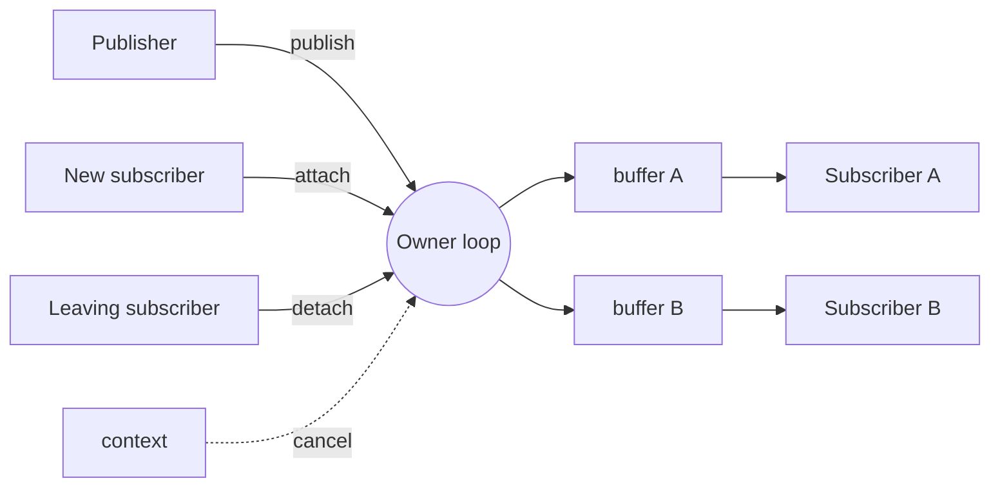

# Online Attach

<!-- meta -->
Let members join and leave a running component without stopping it or racing with its work.

<div class="cp-props" markdown>

| | |
|---|---|
| Purpose | [Coordination](../catalog/purpose.md#purpose-coordination) |
| Scale | [Pattern](../catalog/scale.md#scale-pattern) |
| Mechanisms | [Channels](../catalog/mechanism.md#mechanism-channels), [Select](../catalog/mechanism.md#mechanism-select), [Context](../catalog/mechanism.md#mechanism-context) |
| Concerns | [Data race safety](../catalog/concern.md#concern-data-race-safety), [Composition](../catalog/concern.md#concern-composition) |
| Concepts | [Confinement](../concepts/confinement.md), [Channel Ownership](../concepts/channel-ownership.md), [Memory Visibility](../concepts/memory-visibility.md) |
| Code | [`patterns/onlineattach`](https://github.com/johnknl/go-concurrency-patterns/tree/main/patterns/onlineattach) |

</div>
<!-- /meta -->

## Problem

A running component works on behalf of a changing set of participants, such as subscribers, connections or workers.
Participants join and leave while the component is in use. Each change must take effect at a well-defined point
between two units of work, without a lock that every unit of work and every change has to take, and without
stopping the component.

## Mechanism

The member set lives in one owner goroutine ([confinement](../concepts/confinement.md#owner-goroutine)), which
applies attach and detach between its other work. In this example
the component is a [PubSub Hub](pubsub-hub.md): unlike a mutex-guarded hub, it can wait for a slow subscriber, evict
one, or replay a history to a newcomer without holding a lock that long.

The owner runs one loop over the data channel and two request channels, attach and detach. A request is handled
completely before the next message is delivered, so attach, detach and data are totally ordered:

- a new member is offered exactly the messages after its attach, and a replayed history has no gap and no duplicate;
- the owner is the only sender to and closer of a member's channel, so a send on a closed channel cannot happen
  ([channel ownership](../concepts/channel-ownership.md#close-panics)), and the cause is stored before the close
  ([store before close](../concepts/memory-visibility.md#store-before-close));
- delivery policy, in this example a non-blocking send that counts drops, is in one place and needs no lock.



Requests also select on the owner's `done` channel, so a caller does not block forever on a stopped owner; members
and publishers routinely outlive it. The `subs[s]` check on detach makes a second `unsubscribe` harmless instead of
a double close. On shutdown the owner stores the cause, closes every member channel, then closes `done`.

<!-- code: patterns/onlineattach#sub patterns/onlineattach#hub patterns/onlineattach#newHub patterns/onlineattach#hub.run patterns/onlineattach#hub.deliver patterns/onlineattach#hub.subscribe patterns/onlineattach#hub.unsubscribe patterns/onlineattach#hub.publish patterns/onlineattach#Example_onlineAttach:main -->
```go
type sub struct {
	ch  chan int
	err error
}

type hub struct {
	pub     chan int
	attach  chan *sub
	detach  chan *sub
	done    chan struct{}
	dropped int // owned by run, read after done is closed
}

func newHub(ctx context.Context) *hub {
	h := &hub{
		pub:    make(chan int),
		attach: make(chan *sub),
		detach: make(chan *sub),
		done:   make(chan struct{}),
	}

	go h.run(ctx)

	return h
}

func (h *hub) run(ctx context.Context) {
	defer close(h.done)

	subs := map[*sub]bool{}

	var history []int

	for {
		select {
		case msg := <-h.pub:
			history = append(history, msg)
			history = history[max(0, len(history)-2):]

			for s := range subs {
				h.deliver(s, msg)
			}
		case s := <-h.attach:
			for _, msg := range history {
				h.deliver(s, msg)
			}

			subs[s] = true
		case s := <-h.detach:
			if subs[s] {
				delete(subs, s)

				s.err = errDetached
				close(s.ch)
			}
		case <-ctx.Done():
			for s := range subs {
				s.err = context.Cause(ctx)
				close(s.ch)
			}

			return
		}
	}
}

func (h *hub) deliver(s *sub, msg int) {
	select {
	case s.ch <- msg:
	default:
		h.dropped++
	}
}

func (h *hub) subscribe(buffer int) *sub {
	s := &sub{ch: make(chan int, buffer)}

	select {
	case h.attach <- s:
	case <-h.done:
		s.err = errStopped
		close(s.ch)
	}

	return s
}

func (h *hub) unsubscribe(s *sub) {
	select {
	case h.detach <- s:
	case <-h.done:
	}
}

func (h *hub) publish(msg int) {
	select {
	case h.pub <- msg:
	case <-h.done:
	}
}

func main() {
	ctx, cancel := context.WithCancelCause(context.Background())
	errClosed := errors.New("hub closed")

	h := newHub(ctx)

	a := h.subscribe(4)
	b := h.subscribe(4)
	slow := h.subscribe(1)

	h.publish(1)
	h.publish(2)

	h.unsubscribe(b)

	h.publish(3)

	late := h.subscribe(4)

	h.publish(4)

	cancel(errClosed)
	<-h.done

	fmt.Println(drain("a", a))
	fmt.Println(drain("b", b))
	fmt.Println(drain("late", late))
	fmt.Println(drain("slow", slow))
	fmt.Println("dropped", h.dropped)

	// Output:
	// a [1 2 3 4] hub closed
	// b [1 2] detached
	// late [2 3 4] hub closed
	// slow [1] hub closed
	// dropped 3
}
```
<!-- /code -->

The late subscriber attaches after message 3, receives messages 2 and 3 from the history, then 4 live. The slow
subscriber, with a buffer of one, keeps only the first message.

## Composition

<!-- composition -->
- [For-Select Loop](for-select-loop.md): the owner waits for data, attach and detach requests, and cancellation.
- [Close with Cause](close-with-cause.md): the owner records why a member was detached before closing its channel.
- [Replay Buffer](replay-buffer.md): a new member gets the recent history before live messages.
- [Load Shedding](load-shedding.md): a full member loses the message instead of blocking the owner.
<!-- /composition -->

## Applicability

Use it when one goroutine already does the work and members change while it runs, when a change must take effect at
a precise point in the stream, or when delivery may wait, time out, or evict. Use a mutex-guarded set, as in
[PubSub Hub](pubsub-hub.md), when there is no owner goroutine to begin with, delivery is non-blocking, and
publishers should deliver in parallel.

## Consequences

- No lock, and no send on a closed channel by construction; late-join semantics are exact.
- Every operation is a channel round trip with a single owner goroutine: it bounds throughput, and a slow delivery
  delays attach and detach as well.
- The owner has a lifecycle: it has to be stopped, and requests to a stopped owner must not block
  ([owner costs](../concepts/confinement.md#owner-costs)).
- With unbuffered request channels, as here, a caller waits until the owner is between two messages, and knows the
  change has taken effect when the call returns.

## Variants

### Buffered requests

Callers do not wait for the owner, but do not know when the change took effect.

### Snapshots

The owner answers requests for the current members or statistics, see
[Snapshot via Owner](snapshot-via-owner.md).

### Command set

Typed commands with replies generalize attach, detach and publish, which is [Active Object](active-object.md).

## Related patterns

- [PubSub Hub](pubsub-hub.md) is the most common user, and shows the mutex-guarded alternative.
- [Active Object](active-object.md) generalizes the owner loop to arbitrary commands.

## Sources

<!-- sources -->
- [The Gorilla WebSocket Authors (2013)](../sources.md#source-gorilla-chat)
<!-- /sources -->
