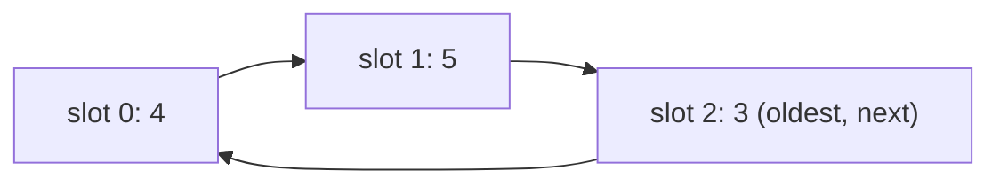
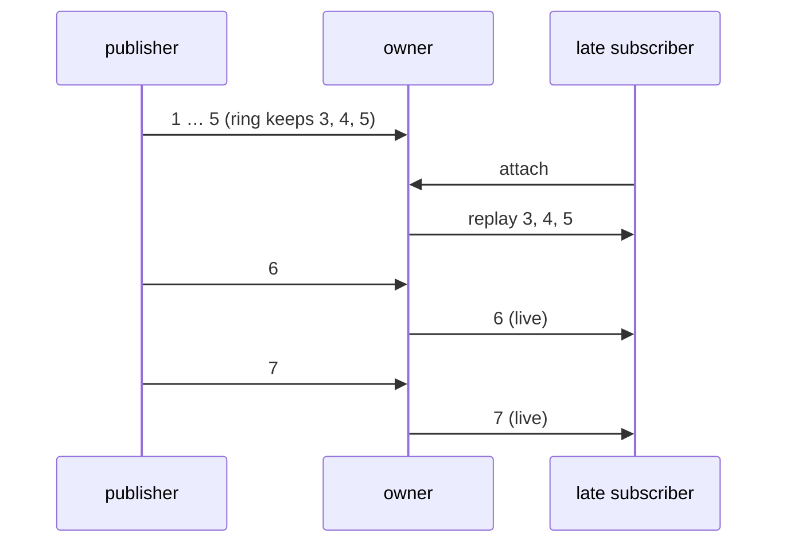

# Replay Buffer

<!-- meta -->
Let a late subscriber catch up on the last n messages before it receives live ones.

<div class="cp-props" markdown>

| | |
|---|---|
| Purpose | [Data flow](../catalog/purpose.md#purpose-data-flow) |
| Scale | [Idiom](../catalog/scale.md#scale-idiom) |
| Mechanisms | [Channels](../catalog/mechanism.md#mechanism-channels), [Sync](../catalog/mechanism.md#mechanism-sync) |
| Concerns | [Composition](../catalog/concern.md#concern-composition) |
| Concepts | [Confinement](../concepts/confinement.md), [Overload Policy](../concepts/overload-policy.md) |
| Code | [`patterns/replaybuffer`](https://github.com/johnknl/go-concurrency-patterns/tree/main/patterns/replaybuffer) |

</div>
<!-- /meta -->

## Problem

A subscriber that attaches to a [hub](pubsub-hub.md) misses everything published before. For state-like streams,
such as the last status or the last log lines, a late joiner would know nothing until the next message. Keeping
the last n messages gives it a recent picture. ReactiveX calls this a ReplaySubject.

## Mechanism

A fixed-size ring keeps the newest n messages. On attach, the owner sends the new subscriber the ring, oldest
first, then adds it to the live set. Replay and live delivery must run in the same goroutine: between two messages,
so the subscriber sees no gap and no duplicate. The ring and the set are held by an
[owner goroutine](../concepts/confinement.md#owner-goroutine), as in [Snapshot via Owner](snapshot-via-owner.md). When `in` closes, the owner closes every subscriber channel.

In this example the ring keeps 3 values; after 1 to 5 were published, it holds 3, 4, 5, and `next` points at the
slot the next value overwrites:





<!-- code: patterns/replaybuffer#ring patterns/replaybuffer#newRing patterns/replaybuffer#ring.add patterns/replaybuffer#ring.all patterns/replaybuffer#owner patterns/replaybuffer#Example_replay:main -->
```go
type ring struct {
	items []int
	next  int
	count int
}

func newRing(n int) *ring { return &ring{items: make([]int, n)} }

func (r *ring) add(v int) {
	r.items[r.next] = v
	r.next = (r.next + 1) % len(r.items)
	r.count = min(r.count+1, len(r.items))
}

func (r *ring) all() iter.Seq[int] {
	return func(yield func(int) bool) {
		start := (r.next - r.count + len(r.items)) % len(r.items)

		for i := range r.count {
			if !yield(r.items[(start+i)%len(r.items)]) {
				return
			}
		}
	}
}

func owner(in <-chan int, attach <-chan chan int, keep int) {
	history := newRing(keep)

	var subs []chan int

	for {
		select {
		case v, ok := <-in:
			if !ok {
				for _, s := range subs {
					close(s)
				}

				return
			}

			history.add(v)

			for _, s := range subs {
				s <- v
			}
		case s := <-attach:
			for v := range history.all() {
				s <- v
			}

			subs = append(subs, s)
		}
	}
}

func main() {
	in := make(chan int)
	attach := make(chan chan int)

	var wg sync.WaitGroup

	wg.Go(func() { owner(in, attach, 3) })

	for v := 1; v <= 5; v++ {
		in <- v
	}

	late := make(chan int, 8) // large enough for the replay and the live messages
	attach <- late

	in <- 6

	in <- 7

	close(in)
	wg.Wait()

	for v := range late {
		fmt.Println(v)
	}

	// Output:
	// 3
	// 4
	// 5
	// 6
	// 7
}
```
<!-- /code -->

The example's subscriber buffer has room for the replay and the live messages because it is read only after the
owner returns; otherwise the owner would block.

## Applicability

Use it when new subscribers need recent context and n is small and known. For full history, use a log or a store
with offsets. Do not replay events that must not be handled twice.

## Consequences

- A late joiner sees at most n old messages, possibly stale, and cannot tell them from live ones unless marked.
- The replay delays other publishes and attaches.
- Sends block, so one subscriber that does not receive stalls the owner: size buffers for n or apply a
  [per-consumer overload policy](../concepts/overload-policy.md#per-consumer).

## Variants

### Shared lock

Guard ring and subscriber list with a `sync.Mutex`, replaying in the same critical section as the registration.

### Keyed ring

Keep the last value per key.

## Related patterns

- [Online Attach](online-attach.md) and a mutex-guarded [PubSub Hub](pubsub-hub.md) use it for late subscribers.
- [Confinement](../concepts/confinement.md) keeps the ring in one goroutine.

## Sources

<!-- sources -->
- [ReactiveX (n.d.)](../sources.md#source-reactivex-subject), ReplaySubject
<!-- /sources -->
