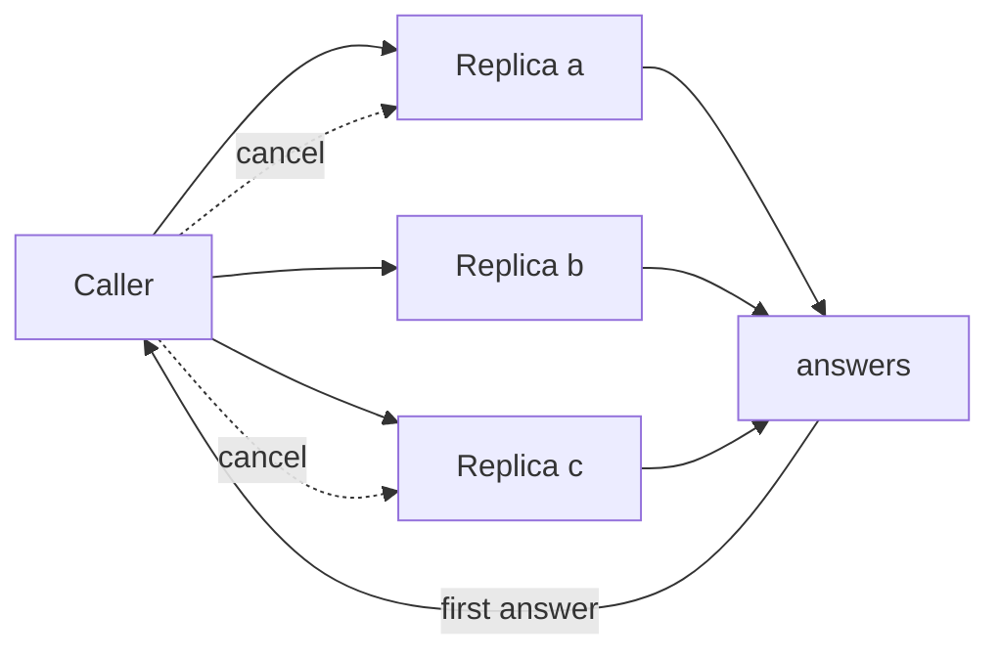

# Request Racing

<!-- meta -->
Get the fastest answer from several equivalent replicas and stop the others.

<div class="cp-props" markdown>

| | |
|---|---|
| Also known as | Replicated requests, Hedged requests (copies sent with a delay) |
| Purpose | [Resilience](../catalog/purpose.md#purpose-resilience) |
| Scale | [Pattern](../catalog/scale.md#scale-pattern) |
| Mechanisms | [Channels](../catalog/mechanism.md#mechanism-channels), [Context](../catalog/mechanism.md#mechanism-context), [Sync](../catalog/mechanism.md#mechanism-sync) |
| Concerns | [Latency](../catalog/concern.md#concern-latency) |
| Concepts | [Goroutine Leak Prevention](../concepts/goroutine-leak-prevention.md), [Cooperative Cancellation](../concepts/cooperative-cancellation.md) |
| Code | [`patterns/racing`](https://github.com/johnknl/go-concurrency-patterns/tree/main/patterns/racing) |

</div>
<!-- /meta -->

## Problem

The response time of a single request varies, and a slow one delays the caller even when equivalent replicas could
have answered sooner. All replicas being slow at once is less likely than one being slow, so sending the request
to several and taking the fastest answer reduces tail latency.


## Mechanism

The caller derives a cancelable context, starts one goroutine per replica, and receives the first answer from a channel
with room for every replica. It then cancels the context and waits with a `sync.WaitGroup` for the others to end. The
buffer is essential: each replica sends exactly once, so it never fills, and without it a loser would block on its send
while `first` waits for it (the same reason a [reply channel has a
buffer](../concepts/goroutine-leak-prevention.md#reply-buffer-one)). `first` needs at least one replica; with none it
blocks forever. Cox-Buday describes the same mechanism as Replicated Requests.



In this example only replica `b` is released, so it wins; the others record their cancellation on `canceled`
before returning.

<!-- code: patterns/racing#replica patterns/racing#first patterns/racing#Example_firstAnswer:main -->
```go
func replica(name string, release <-chan struct{}, canceled chan<- string) func(context.Context) string {
	return func(ctx context.Context) string {
		select {
		case <-release:
			return name
		case <-ctx.Done():
			canceled <- name
			return ""
		}
	}
}

func first(ctx context.Context, replicas ...func(context.Context) string) string {
	ctx, cancel := context.WithCancel(ctx)
	defer cancel()

	answers := make(chan string, len(replicas))

	var wg sync.WaitGroup

	for _, r := range replicas {
		wg.Go(func() { answers <- r(ctx) })
	}

	answer := <-answers

	cancel()
	wg.Wait()

	return answer
}

func main() {
	release := make(chan struct{})
	canceled := make(chan string, 2)

	close(release)

	never := make(chan struct{})

	answer := first(context.Background(),
		replica("a", never, canceled),
		replica("b", release, canceled),
		replica("c", never, canceled),
	)

	close(canceled)

	losers := slices.Sorted(func(yield func(string) bool) {
		for name := range canceled {
			if !yield(name) {
				return
			}
		}
	})

	fmt.Println("answer:", answer)
	fmt.Println("canceled:", losers)

	// Output:
	// answer: b
	// canceled: [a c]
}
```
<!-- /code -->

## Applicability

Use it when several equivalent replicas exist, tail latency matters more than the extra load, and duplicate
requests are safe because the request is idempotent or read-only
([duplicated work](../concepts/cooperative-cancellation.md#duplicates-idempotent)).

## Consequences

- Load and cost grow with the number of replicas; canceled replicas may already have done part of the work.
- Writes with side effects can happen more than once.
- Because `first` waits for every replica, one that ignores its context delays the caller ([ignoring the context delays
  the waiter](../concepts/cooperative-cancellation.md#ignore-delays)). Return without waiting if that is a risk; the
  buffer still lets late replicas finish.
- Replicas that share a failing dependency give less benefit.
- An error that arrives first wins too, unless the caller filters errors and waits for a success.

## Variants

### Hedged request

Send to one replica first and add more only after a delay: less extra load, a slower start in the slow case.

## Related patterns

- [Healing Goroutines](healing-goroutines.md) restarts one stuck goroutine instead of racing several.
- [Future](future.md) can represent the pending answer of each replica.
- [Fan-Out/Fan-In](fan-out-fan-in.md) also starts several goroutines and merges their results, but uses all of them.

## Sources

<!-- sources -->
- [Cox-Buday (2017)](../sources.md#source-cox-buday), Ch. 5, "Replicated Requests"
- [Dean and Barroso (2013)](../sources.md#source-dean-barroso-2013)
<!-- /sources -->
