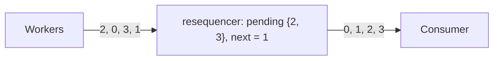

# Resequencer

<!-- meta -->
Consume results in input order when concurrent work delivers them out of order.

<div class="cp-props" markdown>

| | |
|---|---|
| Also known as | Reorder buffer |
| Purpose | [Data flow](../catalog/purpose.md#purpose-data-flow) |
| Scale | [Pattern](../catalog/scale.md#scale-pattern) |
| Mechanisms | [Channels](../catalog/mechanism.md#mechanism-channels) |
| Concerns | [Ordering](../catalog/concern.md#concern-ordering) |
| Concepts | [Ordering](../concepts/ordering.md), [Backpressure](../concepts/backpressure.md) |
| Code | [`patterns/resequencer`](https://github.com/johnknl/go-concurrency-patterns/tree/main/patterns/resequencer) |

</div>
<!-- /meta -->

## Problem

Items are processed concurrently, and the results must be consumed in the order the items came in. Concurrent work
finishes in any order, so a later result may arrive before an earlier one. Making the workers wait for each other
would give up the concurrency.

## Mechanism

The source tags each item with a sequence number: any increasing key works, as long as the resequencer always knows
the key that comes next. In this example the numbers are contiguous integers from 0. `resequence` runs in the
caller's goroutine: it keeps early items in a map by sequence number and emits the next expected one whenever it is
present, advancing as far as it can.



The map is bounded: more than `limit` items behind a gap is an error, as is a duplicate or an input that ends with
a gap open. On an error it stops receiving, and the caller must stop the senders.

<!-- code: patterns/resequencer#item patterns/resequencer#resequence:doc patterns/resequencer#Example_resequence:main -->
```go
type item struct {
	val string
	seq int
}

// resequence receives items in any order and calls emit with them in sequence order, in the caller's goroutine.
// It holds at most limit items that arrived ahead of a gap; one more, a duplicate, or an input that ends with a
// gap still open is an error. On an error it returns at once and stops receiving, so the caller must stop the
// senders.
func resequence(in <-chan item, limit int, emit func(item)) error {
	pending := make(map[int]item, limit)
	next := 0

	for it := range in {
		if _, ok := pending[it.seq]; ok || it.seq < next {
			return fmt.Errorf("seq %d: %w", it.seq, errDuplicate)
		}

		pending[it.seq] = it

		for {
			v, ok := pending[next]
			if !ok {
				break
			}

			delete(pending, next)
			emit(v)
			next++
		}

		if len(pending) > limit {
			return fmt.Errorf("waiting for seq %d with %d buffered: %w", next, len(pending), errGapTooLarge)
		}
	}

	if len(pending) > 0 {
		return fmt.Errorf("seq %d: %w", next, errMissing)
	}

	return nil
}

func main() {
	in := make(chan item, 5)
	for _, seq := range []int{2, 0, 4, 1, 3} {
		in <- item{seq: seq, val: string(rune('a' + seq))}
	}
	close(in)

	err := resequence(in, 4, func(it item) { fmt.Print(it.val, " ") })
	fmt.Println(err)

	// Output:
	// a b c d e <nil>
}
```
<!-- /code -->

**A missing item.** The bound turns a silent stall into an error.

<!-- code: patterns/resequencer#Example_gap:main -->
```go
func main() {
	in := make(chan item, 4)
	for _, seq := range []int{0, 2, 3, 4} {
		in <- item{seq: seq, val: fmt.Sprint(seq)}
	}
	close(in)

	err := resequence(in, 2, func(it item) { fmt.Print(it.val, " ") })
	fmt.Println(err)

	// Output:
	// 0 waiting for seq 1 with 3 buffered: too many items buffered behind a gap
}
```
<!-- /code -->

## Applicability

Use it when work runs concurrently for throughput but output must keep input order (lines, frames, log records),
and every item yields exactly one result. When order does not matter, consume in completion order. When all
results are needed before any is used, write each into its slot of a slice, as in
[Fan-Out/Fan-In](fan-out-fan-in.md).

## Consequences

- A slow item delays every result behind it, even finished ones: head-of-line blocking
  ([cost of restoring order](../concepts/ordering.md#restore-cost)).
- The number of workers does not bound the gap: while one worker is stuck on item `n`, the others keep finishing
  later items. The bound comes from the resequencer (fail at a limit) or the source (a window, below).
- Each next key must be known in advance and keys must be unique ([per-key order](../concepts/ordering.md#per-key)); `resequence` reports repeats, and skips surface as a
  gap.

## Variants

### Ordered Fan-Out with a window

The source takes a token from a buffered channel of size `window` before dispatching an item; the resequencer returns it
on emitting that item. The buffer then holds at most `window-1`, so the policy at the limit is to wait
([backpressure](../concepts/backpressure.md#feedback)), and throughput is still that of the
[slowest item](../concepts/backpressure.md#slowest-stage). The item at the head of the gap always holds a token, so the
window
cannot deadlock.

<!-- code: patterns/resequencer#orderedMap:doc patterns/resequencer#Example_orderedMap:main -->
```go
// orderedMap applies f to vals with the given number of workers and returns the results in input order. A token
// taken before an item is dispatched and returned when its result is emitted keeps at most window items between
// the source and the output, so the resequencer never holds more than window-1, and with contiguous, unique
// sequence numbers it cannot fail. The source goroutine, the workers, and the closer all end before it returns.
func orderedMap(vals []string, workers, window int, f func(string) string) ([]string, error) {
	tokens := make(chan struct{}, window)
	jobs := make(chan item)
	results := make(chan item)

	go func() {
		defer close(jobs)

		for i, v := range vals {
			tokens <- struct{}{}
			jobs <- item{seq: i, val: v}
		}
	}()

	var wg sync.WaitGroup

	for range workers {
		wg.Go(func() {
			for it := range jobs {
				results <- item{seq: it.seq, val: f(it.val)}
			}
		})
	}

	done := make(chan struct{})

	go func() {
		defer close(done)

		wg.Wait()
		close(results)
	}()

	out := make([]string, 0, len(vals))
	err := resequence(results, window, func(it item) {
		out = append(out, it.val)
		<-tokens
	})

	<-done

	return out, err
}

func main() {
	words := strings.Fields("the results come back in input order")

	out, err := orderedMap(words, 3, 4, strings.ToUpper)
	fmt.Println(out, err)

	// Output:
	// [THE RESULTS COME BACK IN INPUT ORDER] <nil>
}
```
<!-- /code -->

## Related patterns

- [Fan-Out/Fan-In](fan-out-fan-in.md) and [Worker Pool](worker-pool.md) deliver in completion order.
- [Watermark](watermark.md) orders by timestamp across inputs, without sequence numbers.

## Anti-patterns

<!-- antipatterns -->
- [Unbounded Reorder Buffer](../anti-patterns/unbounded-reorder-buffer.md): Hold everything that arrives behind a missing item until it arrives, with no limit, so one slow or lost item stops all output while the buffer grows.
<!-- /antipatterns -->

## Sources

<!-- sources -->
- [Hohpe and Woolf (2003)](../sources.md#source-hohpe-woolf-2003), Resequencer
<!-- /sources -->
