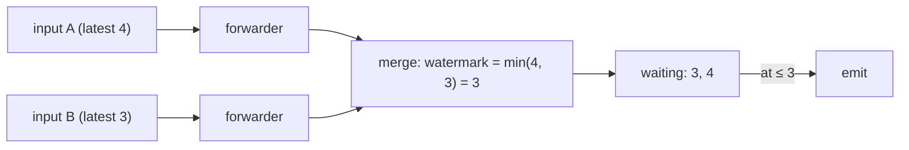
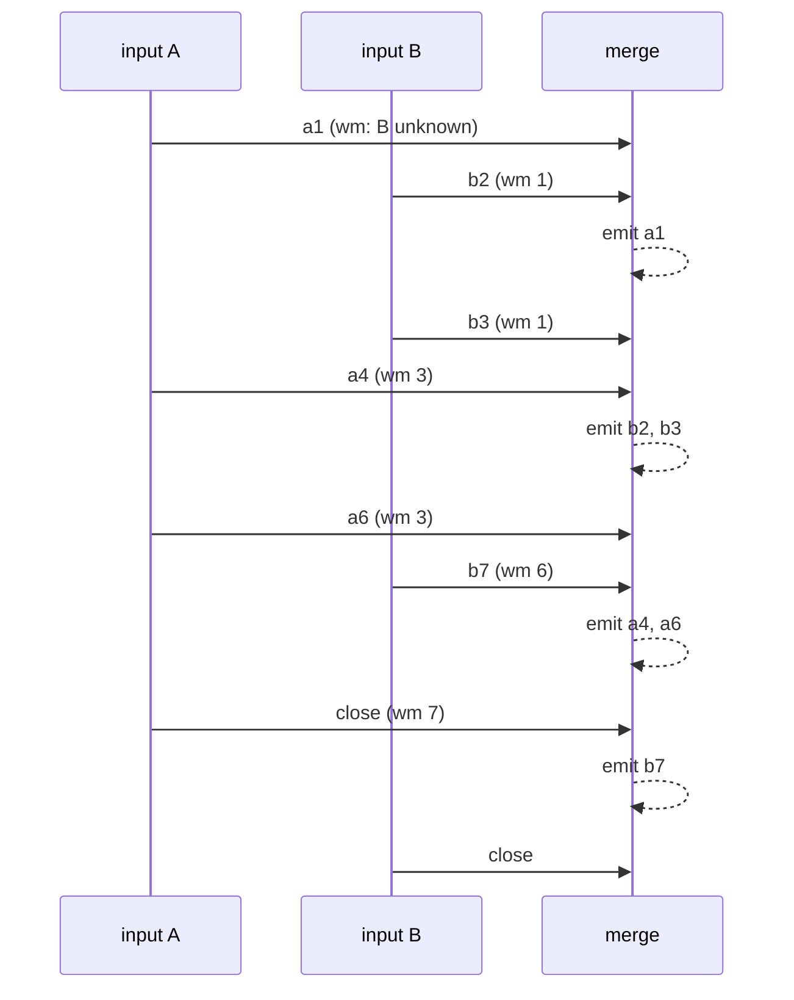

# Watermark

<!-- meta -->
Act on events in the order of their timestamps when they arrive from several inputs at different speeds, without guessing how long to wait for the slower ones.

<div class="cp-props" markdown>

| | |
|---|---|
| Also known as | Low watermark, Event-time merge |
| Purpose | [Data flow](../catalog/purpose.md#purpose-data-flow) |
| Scale | [Pattern](../catalog/scale.md#scale-pattern) |
| Mechanisms | [Channels](../catalog/mechanism.md#mechanism-channels), [Select](../catalog/mechanism.md#mechanism-select) |
| Concerns | [Ordering](../catalog/concern.md#concern-ordering), [Latency](../catalog/concern.md#concern-latency) |
| Concepts | [Ordering](../concepts/ordering.md), [Goroutine Leak Prevention](../concepts/goroutine-leak-prevention.md) |
| Code | [`patterns/watermark`](https://github.com/johnknl/go-concurrency-patterns/tree/main/patterns/watermark) |

</div>
<!-- /meta -->

## Problem

Several inputs send events stamped with the time they happened. Each input is in time order, but the inputs run at
different speeds, so their merged stream is not ([fan-out loses order](../concepts/ordering.md#fan-out-loses)). To act on events in time order, the consumer must know when no
earlier event can arrive any more. Waiting a fixed delay is a guess: too short and the order breaks, too long and
every event is late.

This page covers watermarks inside one process. Triggers, retractions, session windows, and watermarks across
machines belong to stream processing systems ([Akidau et al., 2015](../sources.md#source-akidau-2015);
[Akidau et al., 2018](../sources.md#source-akidau-2018)).

## Mechanism

An input that has sent time *t* sends nothing earlier. The least latest time over all open inputs is the watermark;
buffered events at or below it are emitted in time order. One forwarder goroutine per input tags messages; `merge`
owns all state in the caller's goroutine.



One possible arrival order in the example below; the output is the same for any order:



<!-- code: patterns/watermark#message patterns/watermark#merge patterns/watermark#watermark patterns/watermark#forward patterns/watermark#before -->
```go
type message struct {
	value string
	at    int
	punct bool
}

func merge(ctx context.Context, inputs []<-chan message, limit int, emit func(message)) error {
	ctx, cancel := context.WithCancel(ctx)

	var wg sync.WaitGroup
	defer wg.Wait()
	defer cancel()

	in := make(chan tagged)
	for i, input := range inputs {
		wg.Go(func() { forward(ctx, i, input, in) })
	}

	latest := make(map[int]int) // per open input that has sent; open inputs that have not sent are absent
	open := len(inputs)
	closed := make([]bool, len(inputs))
	var waiting []tagged // ordered by before

	for seq := 0; open > 0; seq++ {
		var t tagged
		select {
		case <-ctx.Done():
			return ctx.Err()
		case t = <-in:
		}
		t.seq = seq

		switch {
		case t.closed:
			closed[t.input] = true
			delete(latest, t.input)
			open--
		case t.msg.punct:
			latest[t.input] = t.msg.at
		default:
			latest[t.input] = t.msg.at
			i, _ := slices.BinarySearchFunc(waiting, t, before)
			waiting = slices.Insert(waiting, i, t)
		}

		wm, ok := watermark(latest, open)
		for ok && len(waiting) > 0 && waiting[0].msg.at <= wm {
			emit(waiting[0].msg)
			waiting = waiting[1:]
		}

		if len(waiting) > limit {
			return errFull
		}
	}

	return nil
}

func watermark(latest map[int]int, open int) (int, bool) {
	if len(latest) < open {
		return 0, false
	}

	if open == 0 {
		return math.MaxInt, true
	}

	return slices.Min(slices.Collect(maps.Values(latest))), true
}

func forward(ctx context.Context, i int, input <-chan message, out chan<- tagged) {
	for {
		t := tagged{input: i}

		select {
		case <-ctx.Done():
			return
		case m, ok := <-input:
			t.msg, t.closed = m, !ok
		}

		select {
		case <-ctx.Done():
			return
		case out <- t:
		}

		if t.closed {
			return
		}
	}
}

func before(a, b tagged) int {
	return cmp.Or(cmp.Compare(a.msg.at, b.msg.at), cmp.Compare(a.input, b.input), cmp.Compare(a.seq, b.seq))
}
```
<!-- /code -->

- **Watermark.** An open input that has not sent yet holds it back; a closed input no longer counts.
- **Emission.** Equal times come out by input, then arrival, so the output does not depend on how forwarders
  interleave.
- **Bound.** More than `limit` waiting events returns `errFull` ([principle 5](../index.md#principle-bounded)).
  Dropping, or pausing inputs that are ahead, are alternatives.
- **Lifetimes.** `merge` cancels its context on return and waits for the forwarders, which watch it on receive and
  send ([select on done](../concepts/goroutine-leak-prevention.md#select-on-done)), so none leaks even if an input
  never closes.

**Merging two inputs.**

<!-- code: patterns/watermark#send patterns/watermark#Example_merge:main -->
```go
func send(msgs ...message) <-chan message {
	input := make(chan message)

	go func() {
		defer close(input)

		for _, m := range msgs {
			input <- m
		}
	}()

	return input
}

func main() {
	a := send(message{at: 1, value: "a1"}, message{at: 4, value: "a4"}, message{at: 6, value: "a6"})
	b := send(message{at: 2, value: "b2"}, message{at: 3, value: "b3"}, message{at: 7, value: "b7"})

	err := merge(context.Background(), []<-chan message{a, b}, 10, func(m message) {
		fmt.Println(m.at, m.value)
	})
	fmt.Println("err:", err)

	// Output:
	// 1 a1
	// 2 b2
	// 3 b3
	// 4 a4
	// 6 a6
	// 7 b7
	// err: <nil>
}
```
<!-- /code -->

**Idle inputs.** An input with nothing to report holds the watermark back forever, and the others' events pile up
to the bound. The source must send a punctuation, "no events before *t*"
([Tucker et al., 2003](../sources.md#source-tucker-2003)), periodically or when its clock moves, much like a
[Heartbeat](heartbeat.md). Declaring an input idle after a timeout keeps output moving, but an event it sends later
may precede events already emitted: a timeout trades correctness for liveness.

**A punctuation from an idle input.**

<!-- code: patterns/watermark#Example_punctuation:main -->
```go
func main() {
	a := make(chan message)
	idle := make(chan message)
	seen := make(chan struct{})

	go func() {
		defer close(a)

		for _, at := range []int{1, 2, 3} {
			a <- message{at: at, value: "a"}
		}
		<-seen
	}()

	go func() {
		defer close(idle)

		idle <- message{at: 10, punct: true}
		<-seen
	}()

	err := merge(context.Background(), []<-chan message{a, idle}, 10, func(m message) {
		fmt.Println(m.at, m.value)
		if m.at == 3 {
			close(seen)
		}
	})
	fmt.Println("err:", err)

	// Output:
	// 1 a
	// 2 a
	// 3 a
	// err: <nil>
}
```
<!-- /code -->

## Applicability

Use it when events carry their own time, the result must follow it, and each input is time-ordered and can send
punctuations. With contiguous sequence numbers, a [Resequencer](resequencer.md) waits for exactly the missing item.
For arrival order or wall-clock spans, use [Windowing](windowing.md). Across machines, or with updates to emitted
results, use a stream processing system.

## Consequences

- No guessed delay; latency is that of the slowest input, which with a small limit makes `merge` fail
  ([cost of restoring order](../concepts/ordering.md#restore-cost)).
- An input that breaks its ordering is not detected and its event comes out of order; a check costs one comparison
  per message.
- One goroutine per input. Watermark recomputation scans the inputs and an insert moves up to `limit` events;
  for a large limit use a min-heap (`container/heap`).

## Variants

### Event-time tumbling windows

Fixed spans of event time, each emitted once the watermark passes its end. The input is one out-of-order stream
with punctuations carrying the watermark, such as the output of `merge`. Allowed lateness keeps a window open a
while longer; an event for an emitted window is late and goes to a callback. Open windows are bounded like the
buffer.

<!-- code: patterns/watermark#window patterns/watermark#windows patterns/watermark#Example_windows:main -->
```go
type window struct {
	start int
	count int
}

func windows(
	ctx context.Context, in <-chan message, size, lateness, limit int, emit func(window), late func(message),
) error {
	open := make(map[int]int) // window start -> count
	wm := math.MinInt

	for {
		var m message
		var ok bool
		select {
		case <-ctx.Done():
			return ctx.Err()
		case m, ok = <-in:
		}

		if !ok {
			wm = math.MaxInt
		} else if m.punct {
			wm = max(wm, m.at)
		} else {
			start := m.at - m.at%size
			if _, isOpen := open[start]; !isOpen && start+size+lateness <= wm {
				late(m)
			} else {
				open[start]++
			}
		}

		for _, start := range slices.Sorted(maps.Keys(open)) {
			if start+size+lateness > wm {
				break
			}
			emit(window{start: start, count: open[start]})
			delete(open, start)
		}

		if len(open) > limit {
			return errFull
		}

		if !ok {
			return nil
		}
	}
}

func main() {
	in := send(
		message{at: 1}, message{at: 3}, message{at: 6},
		message{at: 6, punct: true},
		message{at: 4}, // behind the watermark, within the allowed lateness
		message{at: 8, punct: true},
		message{at: 2}, // its window has been emitted
		message{at: 9},
	)

	err := windows(context.Background(), in, 5, 2, 10,
		func(w window) { fmt.Printf("[%d, %d): %d events\n", w.start, w.start+5, w.count) },
		func(m message) { fmt.Println("late:", m.at) },
	)
	fmt.Println("err:", err)

	// Output:
	// [0, 5): 3 events
	// late: 2
	// [5, 10): 2 events
	// err: <nil>
}
```
<!-- /code -->

## Related patterns

- [Resequencer](resequencer.md) is the special case where progress is a contiguous counter.
- [Windowing](windowing.md) groups by processing time.
- [Fan-Out/Fan-In](fan-out-fan-in.md) merges inputs in arrival order.

## Anti-patterns

<!-- antipatterns -->
- [Sleeping to Synchronize](../anti-patterns/sleep-synchronization.md): Use time.Sleep or a guessed delay to wait for another goroutine instead of waiting for its completion.
- [Unbounded Reorder Buffer](../anti-patterns/unbounded-reorder-buffer.md): Hold everything that arrives behind a missing item until it arrives, with no limit, so one slow or lost item stops all output while the buffer grows.
<!-- /antipatterns -->

## Sources

<!-- sources -->
- [Akidau et al. (2013)](../sources.md#source-akidau-2013)
- [Akidau et al. (2015)](../sources.md#source-akidau-2015)
- [Akidau et al. (2018)](../sources.md#source-akidau-2018)
- [Tucker et al. (2003)](../sources.md#source-tucker-2003)
<!-- /sources -->
