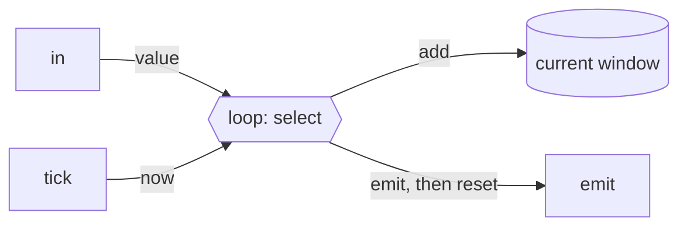
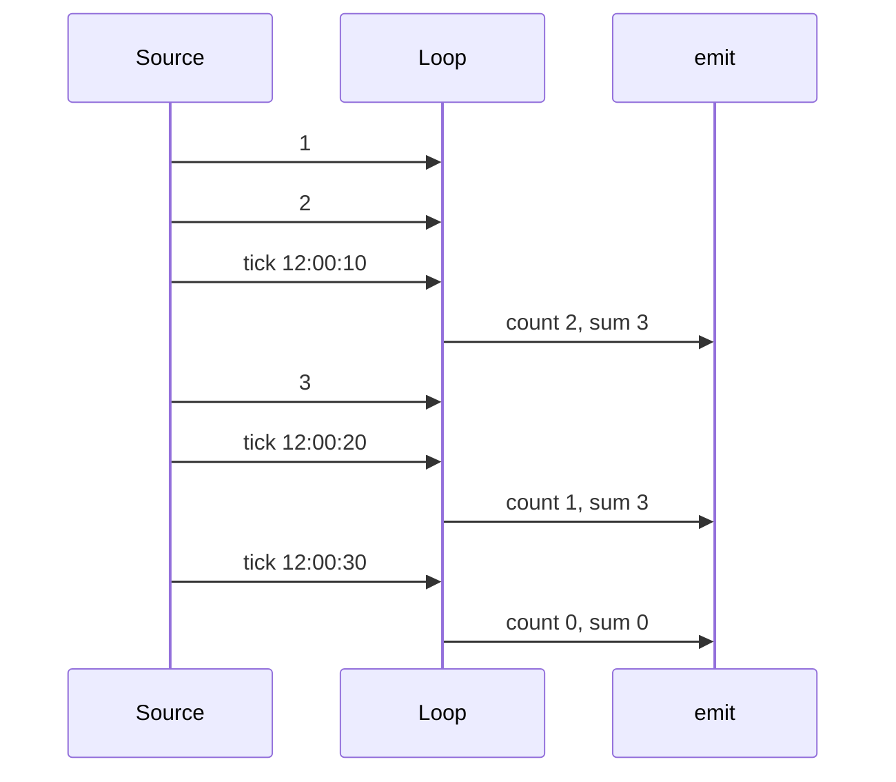

# Windowing

<!-- meta -->
Compute a count, sum, or other aggregate over each span of time of a stream, for fixed spans or for the most recent one.

<div class="cp-props" markdown>

| | |
|---|---|
| Also known as | Time bucketing |
| Purpose | [Data flow](../catalog/purpose.md#purpose-data-flow) |
| Scale | [Idiom](../catalog/scale.md#scale-idiom) |
| Mechanisms | [Time](../catalog/mechanism.md#mechanism-time), [Channels](../catalog/mechanism.md#mechanism-channels), [Select](../catalog/mechanism.md#mechanism-select) |
| Concerns | [Batching](../catalog/concern.md#concern-batching) |
| Concepts | [Timers and Tickers](../concepts/timers.md) |
| Code | [`patterns/windowing`](https://github.com/johnknl/go-concurrency-patterns/tree/main/patterns/windowing) |

</div>
<!-- /meta -->

## Problem

Many measures of a stream, such as requests per second or errors in the last five minutes, are summaries over
spans of processing time, the time at which values arrive. The stream has to be cut into such spans and each span
reported as one aggregate. Tumbling windows are fixed and disjoint; sliding windows overlap and cover the most
recent span at each step ([Akidau et al., 2015](../sources.md#source-akidau-2015)).

## Mechanism

A [For-Select Loop](for-select-loop.md) owns one window. It adds each value from the input to the current window
and, at each tick, reports the window and starts an empty one. The tick channel is a parameter: a program passes a
`time.Ticker`'s `C`; the examples send ticks by hand.



Each value falls into the window that is open when it arrives. In this example the values 1 and 2 arrive before the
tick at 12:00:10, 3 before the tick at 12:00:20, and nothing before 12:00:30:



<!-- code: patterns/windowing#window patterns/windowing#tumbling patterns/windowing#feed patterns/windowing#Example_tumbling:main -->
```go
type window struct {
	end   time.Time
	count int
	sum   int
}

func tumbling(ctx context.Context, in <-chan int, tick <-chan time.Time, emit func(window)) error {
	var w window

	for {
		select {
		case <-ctx.Done():
			return ctx.Err()
		case v, ok := <-in:
			if !ok {
				w.end = time.Now()
				emit(w)
				return nil
			}
			w.count++
			w.sum += v
		case now := <-tick:
			w.end = now
			emit(w)
			w = window{}
		}
	}
}

func feed(cancel context.CancelFunc, steps ...any) (<-chan int, <-chan time.Time) {
	in := make(chan int)
	tick := make(chan time.Time)

	go func() {
		defer cancel()

		for _, s := range steps {
			switch s := s.(type) {
			case int:
				in <- s
			case time.Time:
				tick <- s
			}
		}
	}()

	return in, tick
}

func main() {
	ctx, cancel := context.WithCancel(context.Background())
	in, tick := feed(cancel, 1, 2, at(10), 3, at(20), at(30))

	_ = tumbling(ctx, in, tick, func(w window) {
		fmt.Printf("%s: count %d, sum %d\n", w.end.Format(time.TimeOnly), w.count, w.sum)
	})

	// Output:
	// 12:00:10: count 2, sum 3
	// 12:00:20: count 1, sum 3
	// 12:00:30: count 0, sum 0
}
```
<!-- /code -->

- Every tick reports, also an empty window, so "no traffic" differs from "no report".
- When the input closes, the window in progress is reported, so no value is lost.
- `emit` runs in the loop. While it blocks, values wait and a `time.Ticker` [drops
  ticks](../concepts/timers.md#ticker-drops),
  so the next window spans more than one period. The program that owns the ticker may `defer Stop`, but
  [need not](../concepts/timers.md#stop-optional).

## Applicability

Use it for rates, counts, and sums per span of wall-clock time when arrival time is what matters. A
[Batcher](batcher.md) hands over the items themselves for one bulk operation. For event time, use the windows of
[Watermark](watermark.md).

## Consequences

- An upstream delay moves values into a later window.
- Windows start at the ticker's start; align the first tick for round clock times.
- A sliding window reports partial totals until it has seen `n` periods.
- The aggregate must be incremental (count, sum, min, max); a median needs the values in a bounded buffer.

## Variants

### Sliding window

A ring of `n` per-period buckets; each tick reports the total and clears the next bucket. Memory is `n` buckets
whatever the traffic.

<!-- code: patterns/windowing#bucket patterns/windowing#sliding patterns/windowing#Example_sliding:main -->
```go
type bucket struct {
	count int
	sum   int
}

func sliding(ctx context.Context, in <-chan int, tick <-chan time.Time, n int, emit func(window)) error {
	ring := make([]bucket, n)
	i := 0

	total := func(end time.Time) window {
		w := window{end: end}
		for _, b := range ring {
			w.count += b.count
			w.sum += b.sum
		}

		return w
	}

	for {
		select {
		case <-ctx.Done():
			return ctx.Err()
		case v, ok := <-in:
			if !ok {
				emit(total(time.Now()))
				return nil
			}
			ring[i].count++
			ring[i].sum += v
		case now := <-tick:
			emit(total(now))
			i = (i + 1) % n
			ring[i] = bucket{}
		}
	}
}

func main() {
	ctx, cancel := context.WithCancel(context.Background())
	in, tick := feed(cancel, 1, 2, at(10), 3, at(20), 4, at(30), at(40))

	_ = sliding(ctx, in, tick, 2, func(w window) {
		fmt.Printf("%s: count %d, sum %d\n", w.end.Format(time.TimeOnly), w.count, w.sum)
	})

	// Output:
	// 12:00:10: count 2, sum 3
	// 12:00:20: count 3, sum 6
	// 12:00:30: count 2, sum 7
	// 12:00:40: count 1, sum 4
}
```
<!-- /code -->

## Related patterns

  [Token Bucket](token-bucket.md) and [Pacing](pacing.md) limit a rate without windows.

## Sources

<!-- sources -->
- [Akidau et al. (2015)](../sources.md#source-akidau-2015)
<!-- /sources -->
