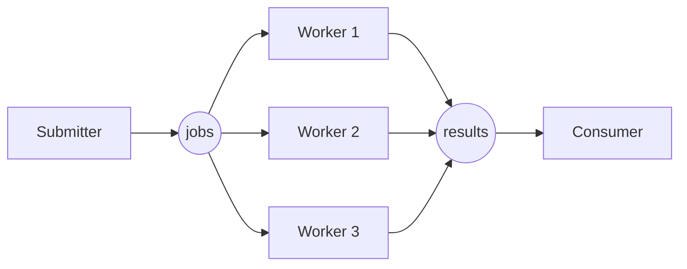

# Worker Pool

<!-- meta -->
Process any number of jobs with a fixed amount of concurrency.

<div class="cp-props" markdown>

| | |
|---|---|
| Also known as | Thread Pool, Executor |
| Purpose | [Execution](../catalog/purpose.md#purpose-execution) |
| Scale | [Pattern](../catalog/scale.md#scale-pattern) |
| Mechanisms | [Channels](../catalog/mechanism.md#mechanism-channels), [Sync](../catalog/mechanism.md#mechanism-sync) |
| Concerns | [Bounded concurrency](../catalog/concern.md#concern-bounded-concurrency), [Backpressure](../catalog/concern.md#concern-backpressure), [Error handling](../catalog/concern.md#concern-error-handling) |
| Concepts | [Channel Ownership](../concepts/channel-ownership.md), [Backpressure](../concepts/backpressure.md) |
| Code | [`patterns/workerpool`](https://github.com/johnknl/go-concurrency-patterns/tree/main/patterns/workerpool) |

</div>

!!! note "Library"
    [`errgroup.Group.SetLimit`](https://pkg.go.dev/golang.org/x/sync/errgroup#Group.SetLimit) bounds the number of active goroutines of a group, and collects the first error; it starts a goroutine per job instead of keeping long-lived workers.
<!-- /meta -->

## Problem

Jobs arrive in any number, but the resources they use allow only a limited number to run at once. Starting a
goroutine per job is cheap; what each job holds while it runs is not. The number of jobs in flight needs a hard
upper bound, and submitters must wait when it is reached.

## Mechanism

A jobs channel, a results channel, and N goroutines that loop over the jobs. Every job produces one result that
carries its identity and its error. The submitter, the [only sender](../concepts/channel-ownership.md#sender-closes), closes the jobs channel when it has
nothing more to send, which ends the workers once they [drain it](../concepts/channel-ownership.md#drain-then-close);
a closer [waits on a `sync.WaitGroup`](../concepts/channel-ownership.md#closer-waits) and closes the results once
they have returned.



<!-- code: patterns/workerpool#result patterns/workerpool#process patterns/workerpool#Example_pool:main -->
```go
type result struct {
	err error
	id  int
	out int
}

func process(id int) (int, error) {
	if id%4 == 0 {
		return 0, errors.New("unlucky")
	}

	return id * 10, nil
}

func main() {
	jobs := make(chan int)
	results := make(chan result)

	var wg sync.WaitGroup

	for range 3 {
		wg.Go(func() {
			for id := range jobs {
				out, err := process(id)
				results <- result{id: id, out: out, err: err}
			}
		})
	}

	go func() {
		defer close(jobs)

		for id := 1; id <= 5; id++ {
			jobs <- id
		}
	}()

	go func() {
		wg.Wait()
		close(results)
	}()

	var all []result
	for r := range results {
		all = append(all, r)
	}

	slices.SortFunc(all, func(a, b result) int { return a.id - b.id })

	for _, r := range all {
		if r.err != nil {
			fmt.Printf("job %d failed: %v\n", r.id, r.err)
			continue
		}

		fmt.Printf("job %d = %d\n", r.id, r.out)
	}

	// Output:
	// job 1 = 10
	// job 2 = 20
	// job 3 = 30
	// job 4 failed: unlucky
	// job 5 = 50
}
```
<!-- /code -->

In this example there are 3 workers and 5 jobs. Sending on the unbuffered jobs channel blocks while all workers are
busy; that is the [backpressure](../concepts/backpressure.md#feedback). The submitter and the consumer must run concurrently: if one goroutine submits
everything before reading results, the workers block delivering results and the submitter blocks on the jobs, a
deadlock.

## Applicability

Use it when jobs share a concurrency limit and the same handler, and the caller wants a result or error per job.
Use a [Semaphore](semaphore.md) when every caller runs its own code. For a slice of jobs known up front, one
goroutine per job under a semaphore, writing each result to its own index, needs no channels, and cheap jobs need
no concurrency at all ([Premature Parallelism](../anti-patterns/premature-parallelism.md)).

## Consequences

- Concurrency never exceeds the number of workers.
- Results arrive in completion order, so a result carries the identity of its job.
- An error is reported as a result and does not stop the pool. To stop on the first error, cancel a context that
  the submitter and the workers select on.
- Forgetting to close the jobs channel leaks the workers.

## Related patterns

- [Fan-Out/Fan-In](fan-out-fan-in.md) is the same mechanism applied to a stream; the pool bounds the work and keeps
  each job's outcome.
- [Resequencer](resequencer.md) restores the input order of the results.
- [Future](future.md) returns the outcome of a single job.

## Anti-patterns

<!-- antipatterns -->
- [Premature Abstraction](../anti-patterns/premature-abstraction.md): Extract a generic, configurable concurrency helper before its uses are known, so each caller sets flags for the behavior it needs, the flags interact, and every caller depends on code paths it does not use.
- [Premature Parallelism](../anti-patterns/premature-parallelism.md): Spread cheap work on data that is already in hand across goroutines and channels, so the handoffs cost more than the work, the order is lost, and a loop's worth of code becomes a pipeline to manage.
- [Unbounded Goroutines](../anti-patterns/unbounded-goroutines.md): Start one goroutine per input item, so concurrency grows with the input instead of with capacity.
<!-- /antipatterns -->

## Sources

<!-- sources -->
- [McGranaghan and Bendersky (n.d.)](../sources.md#source-gobyexample-pools)
<!-- /sources -->
